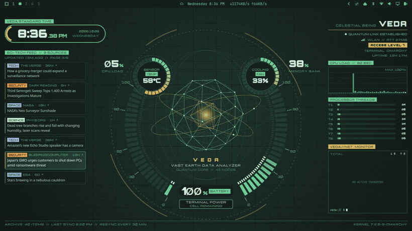
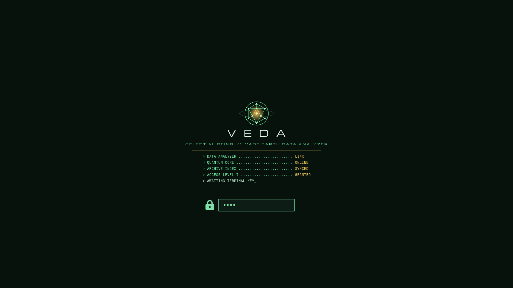
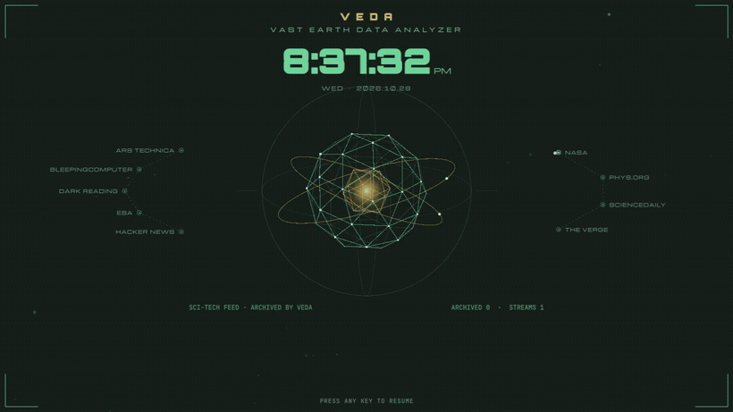
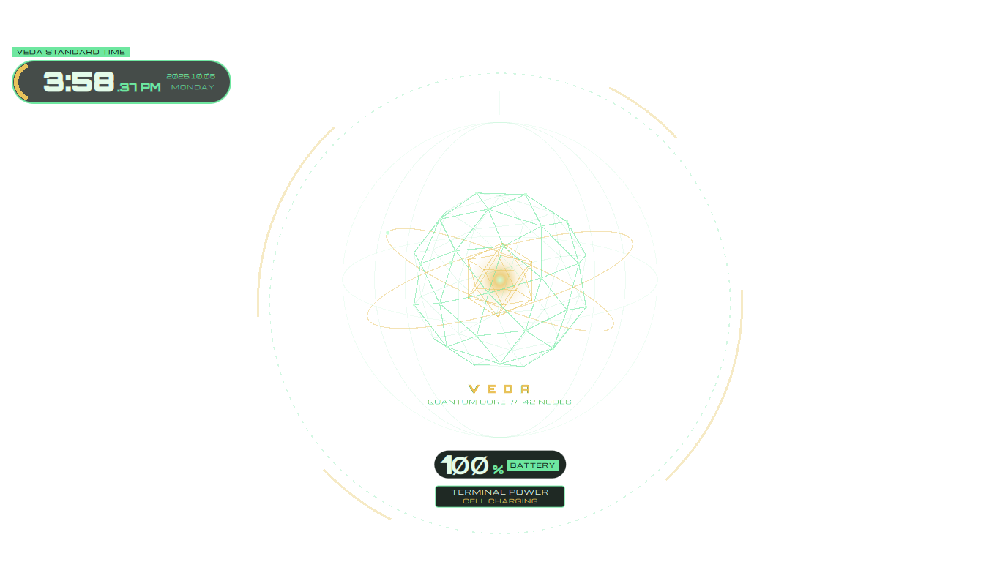
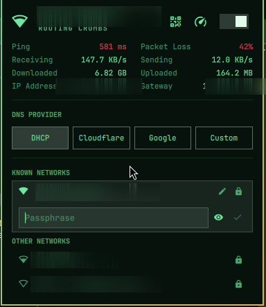
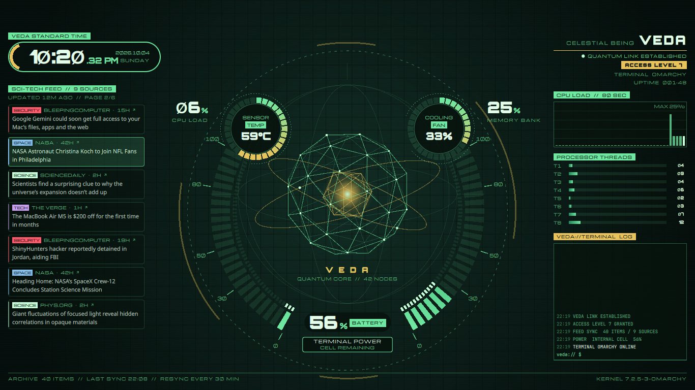

# omarchy-vedacool

> A Gundam 00 / VEDA themed [Omarchy](https://omarchy.org) (Hyprland) desktop — modular, preflight-gated, install one piece at a time.


A modular set of [Omarchy](https://omarchy.org) customisations you can **install one at a time**.

This is my personal Omarchy setup — a Gundam 00 / VEDA themed desktop, a few
Windows-like Hyprland tweaks, hardware fixes for an old laptop, and a self-healing
post-update hook — packaged so **anyone can download the installer, pick the
modules they want, and have them set up automatically**. (I use the same thing to
restore my own machine after a reinstall.)

Every module is **idempotent**, **backs up anything it touches** before editing, and
is gated behind a **dependency + compatibility preflight**. Nothing is changed unless
the preflight passes and you confirm.

## Screenshots

The **VEDA HUD** — an animated desktop overlay with live CPU / temp / fan / battery,
a sci-tech news feed, per-thread load bars, and a terminal log:



**Boot screen** (Plymouth) and **screensaver** — same VEDA language end to end:

| Boot screen | Screensaver |
|:---:|:---:|
|  |  |

**Projection mode** — when an external display/projector is attached, the HUD
strips down to a clean, legible overlay for the big screen:



**WiFi panel** (`vedacool.network`) — a reworked network panel with live ping /
packet-loss / throughput, a DNS-provider switcher, and inline connect + QR
(network names and IP blurred here for privacy):



Three selectable themes:

| VEDA Terminal | GN-00 Raiser (Exia) | Gundam 00 |
|:---:|:---:|:---:|
|  |  |  |

## Install in one line

The installer pulls this repo and runs the picker — no manual clone needed:

```bash
# interactive: checks compatibility, shows the modules, lets you choose
bash <(curl -fsSL https://raw.githubusercontent.com/vedacool/omarchy-vedacool/main/install.sh)
```

Prefer to look before you leap? These change nothing until you say so:

```bash
# dependency + compatibility check only — no changes at all
curl -fsSL https://raw.githubusercontent.com/vedacool/omarchy-vedacool/main/install.sh | bash -s -- --check

# install only the modules you name (skipped automatically if their deps aren't met)
curl -fsSL https://raw.githubusercontent.com/vedacool/omarchy-vedacool/main/install.sh | bash -s -- 20-hypr-desktop 30-chrome-flags --yes

# install everything
curl -fsSL https://raw.githubusercontent.com/vedacool/omarchy-vedacool/main/install.sh | bash -s -- --all --yes
```

The installer clones to `~/omarchy-vedacool`, then hands off to `setup.sh`.

### Pin a version / verify before running

`curl | bash` runs whatever `main` points at right now. If you'd rather run a
reviewed, fixed version, **pin a tag or commit** — the installer clones that
exact ref and prints the commit SHA it's about to run:

```bash
# install a specific tag (reproducible)
OMARCHY_VEDACOOL_REF=v1.0.0 bash <(curl -fsSL https://raw.githubusercontent.com/vedacool/omarchy-vedacool/main/install.sh)
```

Most cautious: **read it first.** Nothing is applied until the preflight passes
and you confirm (`setup.sh` won't change anything without `--yes` or an
interactive *y*), so you can clone, read the modules you want, and run it by hand:

```bash
git clone https://github.com/vedacool/omarchy-vedacool.git ~/omarchy-vedacool
cd ~/omarchy-vedacool && git checkout v1.0.0   # optional: pin a tag
less modules/20-hypr-desktop/module.sh         # read what a module does
DRY_RUN=1 ./setup.sh --all                     # preview every change, touch nothing
```

## Or clone and drive it yourself

```bash
git clone https://github.com/vedacool/omarchy-vedacool.git ~/omarchy-vedacool
cd ~/omarchy-vedacool

./setup.sh --list        # see all modules
./setup.sh --check       # dependency + compatibility check only (no changes)
DRY_RUN=1 ./setup.sh --all   # preview every change, touch nothing
./setup.sh               # interactive menu — pick what you want
./setup.sh 20-hypr-desktop 30-chrome-flags   # just these
./setup.sh --all         # everything
```

`--yes` skips the confirm prompt (for scripts/pipes); `--force` overrides the preflight gate.

## The modules

Pick only what you want — they're independent (a few note a dependency, and the
preflight tells you if your selection is missing one).

| Module | What it sets up | sudo | tuned for |
|---|---|---|---|
| `10-sleep-hibernate` | Lid-close hibernate, Atheros wifi resume fix, single-password wake | ✓ | Atheros wifi |
| `20-hypr-desktop` | Windows-like Hyprland: float-by-default, edge-snap, border resize, SUPER+M/N, auto-hide dock, scale 1/1 | | weak/old GPU |
| `30-chrome-flags` | Chrome: software GPU, Wayland IME, 80% UI | | old GPU / small screen |
| `35-abiword` | AbiWord (lightweight WordPad-style editor) + default for text files | ✓ | |
| `40-dock-pins` | Dock pins: Chrome, Zoom, WhatsApp | | |
| `45-av-jack-notify` | Toast on 3.5mm headphone + HDMI plug/unplug | | |
| `50-desktop-entries` | Claude opens in `~/Work`, WhatsApp pinned to one Chrome profile, agent-window icon | | |
| `60-shell-bar` | Opaque bar, custom bar layout, 12pt font | | needs `70` |
| `70-bar-plugins` | Top-bar pills: netspeed, network, monitor, zoom-controls | | |
| `80-themes` | Gundam 00 themes (veda-terminal, gundam-00-raiser, gundam-00) + HUD fonts | | |
| `82-hud-plugins` | Animated desktop HUDs (GN HUD + VEDA) with live data + news feed | | needs `80` |
| `84-screensaver` | VEDA screensaver wired into idle | | needs `82`, `foot` |
| `90-plymouth-boot` | VEDA boot splash (resets on every kernel/omarchy update) | ✓ | needs `80` |
| `95-verify-hook` | Post-update hook that re-checks + self-heals all of the above after `omarchy update` | | |

## How it works

- **`install.sh`** — one-line bootstrap: clones/updates the repo, hands off to `setup.sh`.
- **`setup.sh`** — the runner: lists modules, runs the preflight, then applies your selection in order.
- **`lib/preflight.sh`** — checks you're on Omarchy, that each module's commands exist, and flags hardware-specific modules when your hardware differs.
- **`lib/common.sh`** — idempotent helpers (append-once, jq edits, root-file install, Hyprland reload + validate + rollback). Everything backs up to `*.bak.setup.<timestamp>` first.
- **`modules/<id>/`** — one folder per module: `module.sh` (metadata + `apply()` + optional compatibility `check()`) and `payload/` (the real files, laid out at their `$HOME`-relative paths).

## Good to know

- **Hardware fit:** modules `10`, `20`, `30` were tuned for an old ASUS laptop (Radeon HD 6730M, Atheros AR9285, 1366×768). They apply safely anywhere, but the preflight **warns** when your hardware differs so you can skip them if you'd rather keep defaults.
- **Reversible:** every edited file gets a `.bak.setup.<timestamp>` copy beside it; nothing is deleted. Hyprland edits are reloaded, validated, and rolled back automatically if they'd cause config errors.
- **Idempotent:** re-running is safe — already-applied changes report `ok` and are skipped.
- **One personal module:** `95-verify-hook` is my own machine's self-heal script with hard-coded paths; the preflight warns if you're not me. Everything else uses your `$HOME` and works on any account.

## Keeping the repo in sync (maintainer)

The repo is a *generated snapshot* of the live machine, so there's no hand-syncing:

```bash
./export.sh            # re-capture all payloads from $HOME, show what changed
./export.sh --commit   # ...and commit the refresh
```

Each module declares `EXPORT_PATHS` (and, for dynamic bits like the bar layout, an
`export_extra()`); `export.sh` pulls those from your live `$HOME` back into
`modules/*/payload`. Change your machine, run `export.sh`, push. Day-to-day update
survival is handled separately by the `95-verify-hook` module, which self-heals after
every `omarchy update`.

## License

MIT — take what's useful. These are personal configs; review a module before you run it.
